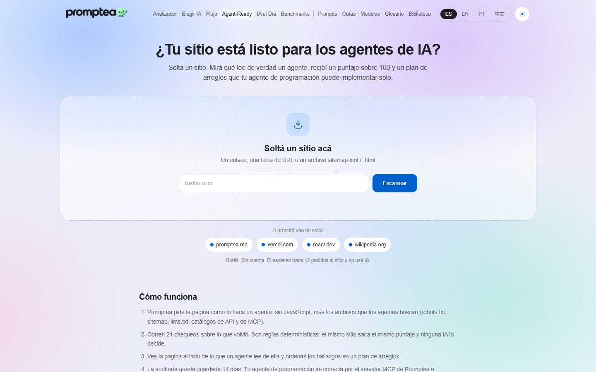
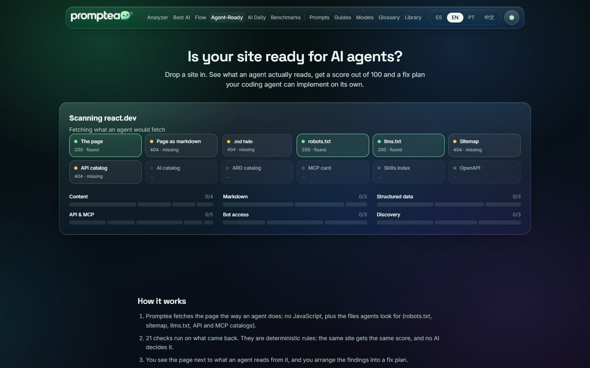
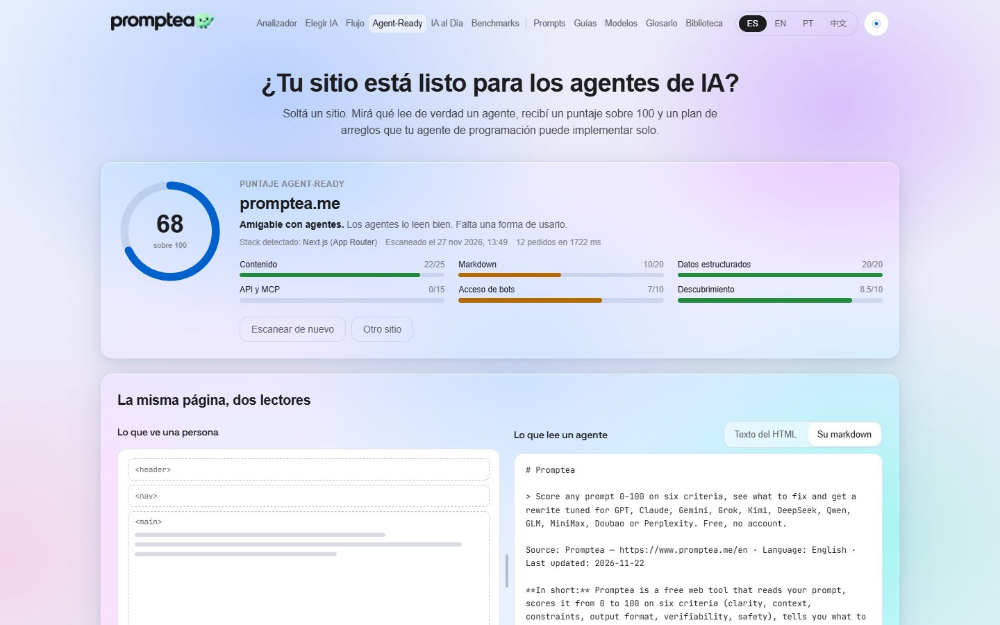
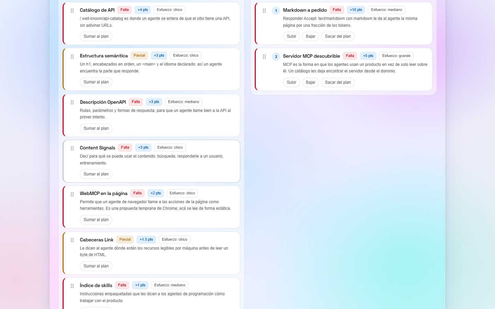
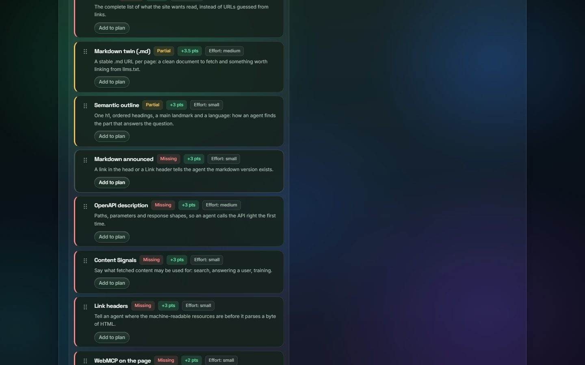
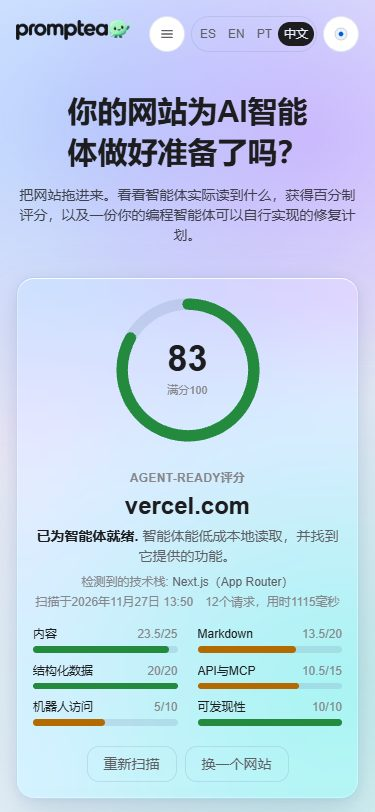

# Promptea v1.9.0: reporte de release

**Agent-Ready: un auditor de qué tan listo está un sitio para los agentes de IA, guardado como una sesión que el agente de programación del dueño lee por el servidor MCP de Promptea. Y Promptea mismo, más fácil de leer para los agentes.**

Fecha: 27/11/2026. Seis PRs apilados (#60 a #64 y este). Nada está mergeado ni desplegado.

## 0. Resumen

| PR | Qué trae | Estado |
| --- | --- | --- |
| #60 | Promptea legible por agentes: markdown por `Accept`, cabeceras `Link`, Content Signals, gemelos de las herramientas, catálogo de API | Abierto |
| #61 | Motor Agent-Ready: fetch seguro contra SSRF, 21 chequeos, puntaje, catálogo de arreglos | Abierto, sobre #60 |
| #62 | Sesiones en Firestore y API de escaneo en streaming | Abierto, sobre #61 |
| #63 | Servidor MCP y descubrimiento (Server Card, catálogo ARD) | Abierto, sobre #62 |
| #64 | La sección `/[lang]/agent-ready` en los cuatro idiomas | Abierto, sobre #63 |
| Este | Versión 1.9.0, changelog, README y este reporte | Abierto, sobre #64 |

**Orden de merge:** #60, #61, #62, #63, #64 y este al final. Al mergear cada uno, GitHub pasa la base del siguiente a `main`.

**Fuera de esta versión, para la 1.9.1** (acordado en el plan): el Flujo v2 (secuenciador con nodos arrastrables, validación por rama y exportación a Orca, Claude Code y Codex) y el paquete npm.

## 1. De dónde partimos

### La versión anterior era la 1.8.9, no la 1.8.8

El pedido hablaba de "la versión después de la 1.8.8". Al revisar el remoto, la 1.8.9 ya estaba mergeada desde el 22/11 (#58) y el checkout local estaba dos commits atrás. Dos cosas cambian por eso:

- **El secuenciador estilo Orca ya existe.** Es el "Flujo de prompts" (`/[lang]/flow`) de la 1.8.9. El post de LinkedIn que lo inspiró (de Gal Gordon) está documentado en `docs/release/v1.8.9/flow-design.md`. Lo que queda para la 1.9.1 es mejorarlo, no crearlo.
- **La versión correcta es la 1.9.0.** Una sección nueva, un servidor MCP y dependencias nuevas justifican el salto de menor, igual que la 1.7.0 y la 1.8.0.

### Cómo estaba Promptea para los agentes (medido en producción el 27/11)

Cloudflare (isitagentready.com) le dio **25 sobre 100, Nivel 1**:

| Área | Resultado | Qué fallaba |
| --- | --- | --- |
| Descubrimiento | 2 de 4 | Sin cabeceras `Link`; sin DNS-AID |
| Contenido | 0 de 1 | `Accept: text/markdown` devolvía HTML |
| Acceso de bots | 1 de 2 | Sin Content Signals |
| API, MCP y skills | 0 de 5 | Sin catálogo de API, server card, índice de skills, WebMCP ni catálogo ARD |

Con el motor propio de esta versión, producción saca hoy **68 sobre 100**. La diferencia con Cloudflare es de criterio: nuestro puntaje le da peso al texto que existe sin JavaScript, al markdown y a los datos estructurados, que Promptea ya tenía.

## 2. Agent-Ready

### Qué hace

1. **Lienzo.** Se suelta un enlace, una ficha de ejemplo, o un archivo `sitemap.xml` o `.html`. El archivo se lee en el navegador; no se sube.
2. **Escaneo en vivo.** Doce pedidos al sitio, dibujados a medida que responde, y 21 chequeos que llenan seis categorías.
3. **Puntaje** de 0 a 100 con cuatro niveles.
4. **Dos lectores.** Lo que ve una persona al lado de lo que lee un agente, con el costo en tokens del HTML, del texto y del markdown.
5. **Hallazgos y plan.** Los hallazgos se arrastran a un plan y se ordenan.
6. **Que lo arregle tu agente.** Un comando conecta Claude Code, Codex o Cursor a la auditoría.

### Capturas

| Lienzo (Aqua) | Escaneo en vivo (Glass) |
| --- | --- |
|  |  |
| **Resultado (Aqua)** | **Hallazgos y plan (Aqua)** |
|  |  |
| **Conectar el agente (Glass)** | **Móvil, chino (375 px)** |
|  |  |

Las demás están en `shots/` (Metro en portugués, y el resto de los pasos en cada tema).

### El puntaje

| Categoría | Puntos | Chequeos |
| --- | --- | --- |
| Contenido | 25 | Texto sin JavaScript (12), estructura semántica (6), título, descripción y canónica (4), peso del HTML (3) |
| Markdown | 20 | Negociación por `Accept` (10), gemelo `.md` (7), anuncio (3) |
| Datos estructurados | 20 | JSON-LD válido (8), tipos de schema.org (7), Open Graph (5) |
| API y MCP | 15 | Catálogo de API (4), OpenAPI (3), MCP (5), WebMCP (2), skills (1) |
| Acceso de bots | 10 | `robots.txt` (3), reglas para IA (4), Content Signals (3) |
| Descubrimiento | 10 | Sitemap (4), cabeceras `Link` (3), `llms.txt` (3) |

- `llms.txt` vale 3 puntos a propósito: hay poca evidencia de que los agentes lo lean solos.
- Rechazar los bots de entrenamiento no resta. Bloquear los que actúan por una persona (ChatGPT-User, Claude-User) sí.
- No interviene ningún LLM: el mismo sitio saca siempre el mismo puntaje.

### La diferencia con un escáner común

La auditoría queda guardada 14 días y tiene su propio servidor MCP:

```
claude mcp add --transport http promptea-audit https://www.promptea.me/api/mcp/<id de sesión>
```

El agente lee la auditoría (`get_audit`), los arreglos en el orden del plan (`list_fixes`), cada arreglo con archivos, código y un comando de aceptación (`get_fix`), marca avances (`mark_fix_done`) y vuelve a escanear después del deploy (`recheck`). La página muestra el avance sin recargar.

## 3. Seguridad

| Riesgo | Qué se hizo |
| --- | --- |
| SSRF: que alguien haga que nuestro servidor pida direcciones internas | Solo `http` y `https` en puertos por defecto, sin credenciales. El host se resuelve una vez, todas las direcciones tienen que ser públicas y el socket se abre a la dirección validada. Redirects a mano y revalidados. Los tests cubren loopback, rangos privados, link-local, CGNAT y las formas de IPv6 que esconden un IPv4 |
| Usar el escáner contra un sitio ajeno | 6 escaneos por minuto por sitio auditado, 5 por minuto y 25 por día por cliente, solo desde el navegador y desde este sitio |
| Respuestas enormes o lentas | 1,5 MB por respuesta (después de descomprimir) y 8 segundos por pedido |
| Que el MCP sirva para leer otra auditoría o pedir otra URL | La sesión va en la URL del servidor. Ninguna herramienta recibe un id ni una URL. `recheck` usa la URL guardada, hasta 30 veces por sesión |
| Texto hostil en la página auditada (inyección al agente) | Por MCP salen números, booleanos, nombres validados y nuestras recetas. El texto de la página no sale. Las recetas son estáticas y solo se les interpola el origen validado |
| Datos personales | La sesión no guarda IP, navegador ni cuenta. El cupo diario usa un hash de la conexión |
| Adivinar una sesión | Id de 128 bits aleatorios. Un id desconocido y uno vencido responden igual |

## 4. Promptea para los agentes

- **Markdown por `Accept`:** una página pedida con `Accept: text/markdown` responde su gemelo en la misma URL.
- **Cabeceras `Link`** hacia `llms.txt`, el catálogo de API, el catálogo ARD, el sitemap y el gemelo de la página.
- **Content Signals** en `robots.txt`: `search=yes, ai-input=yes, ai-train=yes`, derivado de la política de crawlers que ya existía.
- **Gemelos nuevos:** `/analyzer.md`, `/best-ai.md`, `/flow.md` y `/agent-ready.md`.
- **Catálogo de API** (`/.well-known/api-catalog`) y OpenAPI del endpoint público de benchmarks.
- **Descubrimiento del MCP:** Server Card en `/api/mcp/server-card` y catálogo en `/.well-known/ard.json` y `/.well-known/ai-catalog.json`.

**Lo que esto debería cambiar en isitagentready:** markdown, cabeceras `Link`, Content Signals, catálogo de API, server card y catálogo ARD pasan a existir. No lo pude medir: el escáner de Cloudflare solo lee producción.

**Lo que sigue faltando para ese escáner:** DNS-AID, Web Bot Auth, índice de skills y WebMCP. Quedaron fuera a propósito.

## 5. Tests y QA

| Qué | Resultado |
| --- | --- |
| `npm test` | **103 archivos, 2.225 tests**, verde; 8 omitidos (emulador). 97 tests nuevos |
| `npm run test:firestore` (emulador) | **8 de 8**, con la prueba nueva de sesiones y cupo |
| `npm run typecheck` y `npm run lint` | 0 errores, 0 avisos |
| `next build` | OK; `/[lang]/agent-ready` prerenderizado en los 4 idiomas |
| `seo:check` (build local) | **1.094 de 1.094**, con el grupo nuevo `agents` (36 chequeos) |
| `a11y-check` (Chrome real) | **133 de 133** |
| `i18n-qa` (Chrome real) | **280 cargas, 0 fallas** |
| `audit.mjs` (Chrome real) | **500 cargas, 0 hallazgos**: sin errores de consola, sin desborde y con CLS dentro del límite en 25 páginas, los 3 temas y 5 anchos |
| Motor contra sitios reales | promptea.me 68, vercel.com 83, react.dev 37, example.com 3; `169.254.169.254`, `localhost:3000` y `127.0.0.1.nip.io` rechazados |
| Servidor MCP | `initialize`, `tools/list` y `tools/call` por JSON-RPC contra la ruta real |
| A mano en el navegador | Escaneo, arrastre con puntero y con teclado, plan guardado en la sesión, 375 px sin desborde, los tres temas |

El `seo:check` de esta pasada da menos chequeos que el de #60 (1.483) porque este build local se hizo sin base de datos, así que no hay páginas de AI Daily. El motivo está en la sección 7.

**No verificado:**

- **Un cliente MCP real** (Claude Code, Codex o Cursor) conectado al servidor. Hace falta una URL pública: el preview de Vercel o producción.
- **Las rutas nuevas contra el Firestore de producción.** Las probé con el emulador y con sesiones en memoria.
- **La negociación de markdown en Vercel.** Depende de que el proxy corra antes de la caché; en local funciona.
- **El arrastre en un teléfono real** y **un lector de pantalla real**.
- **El botón "Agregar a Cursor"**: el formato sale de la documentación, no lo probé con Cursor instalado.

## 6. Límites conocidos

- **La respuesta HTML no lleva `Vary: Accept`.** Next escribe su propio `Vary` en las páginas y descarta el nuestro. La respuesta markdown sí lo lleva. No hay mezcla en caché: las páginas son `max-age=0, must-revalidate`.
- **WebMCP se detecta leyendo el HTML.** Las herramientas que registra un archivo de script no se ven.
- **Recetas por stack:** Next.js App Router tiene la suya; Pages Router, Astro y WordPress se detectan y reciben la genérica.
- **El límite por minuto es por instancia**, como el resto del sitio. El cupo diario sí es compartido (Firestore).
- **Sin Firestore, el escaneo corre pero no se guarda**, y la página no muestra el paso de conexión.
- **Guías y notas de AI Daily en pt y zh** no se negocian por `Accept`: el gemelo existe guía por guía.

## 7. Qué se escribió afuera del repo

- **GitHub:** seis ramas (`claude/v190-*`) y seis PRs, sin mergear. Cada push genera un preview en Vercel.
- **Producción:** solo lectura. Pedidos `GET` a `www.promptea.me` y una pasada por isitagentready.com.
- **Firestore de producción:** nada escrito. El `.env.local` de la carpeta de trabajo tiene credenciales reales, así que lo aparté antes de probar el escaneo y usé sesiones en memoria.
- **Vercel, npm, Anthropic:** nada.
- **Local:** un worktree en `D:\Claude\promptea-v190` y dos configuraciones de preview en `.claude/launch.json` del checkout principal.

## 8. Qué necesito de vos

1. **Revisar y mergear** en orden: #60, #61, #62, #63, #64 y este.
2. **Decidir el Content Signal de entrenamiento.** Hoy declara `ai-train=yes`, igual que la política de crawlers. Si preferís `no`, se cambia `TRAINING_BOTS_ALLOWED` en `lib/seo/crawlers.ts` (y eso también bloquea a esos bots).
3. **Después del deploy:**
   - correr isitagentready.com contra producción y comparar con el 25 de hoy;
   - escanear un sitio en `/es/agent-ready` y conectar Claude Code con el comando que muestra la página. Es la primera prueba real del servidor MCP;
   - mirar en Firestore que aparezcan `agent_audits` y `agent_audit_quota`.
4. **Opcional:** una política TTL de Firestore sobre `agent_audits.expiresAt` y `agent_audit_quota.expiresAt`.
5. **Opcional:** un mail de contacto para publicar `/.well-known/security.txt`.
6. **Actualizar los checkouts locales:** `D:\Claude\promptea` y el de OneDrive están atrás de `main`. Después de mergear, `git pull` y `graphify update .`.
7. **Siguen pendientes de versiones anteriores**, sin cambios: `CRON_SECRET` y `ROUTINE_ALERT_TO`, la red del entorno de la rutina Tech, los revisores nativos de pt y zh, y la regla de Firewall para Singapur.

## 9. Para la 1.9.1

- **Flujo v2:** sobre `/flow`, nodos arrastrables, un paso de validación por rama, el brief del coordinador y exportación a Orca, Claude Code y Codex.
- **Paquete npm** (`@promptea/agent-ready` o `agent-ready-next`): `check` para CI con el mismo motor, e `init` que instala las rutas y deja la configuración del MCP para que el agente corra auditar, arreglar y volver a auditar. Ya existen `next-agent-ready` (un middleware) y `a14y` (solo puntúa); ninguno cierra ese ciclo.
- **Encontrado y no hecho:** el gemelo markdown del índice `/blog`, y recetas propias para Astro y WordPress.
